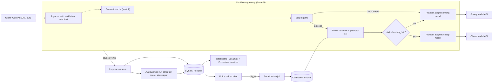
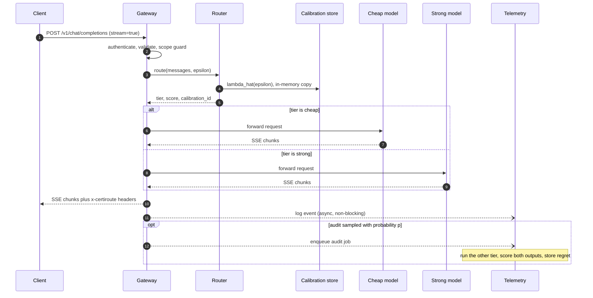
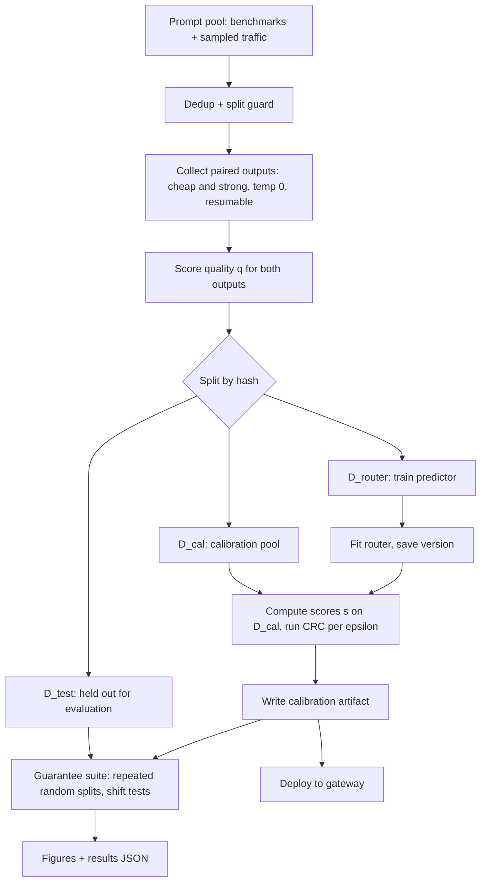

# CertiRoute — Architecture

> Status: design document (pre-alpha). Everything marked **(MVP)** is in scope for the first release; **(stretch)** is not.
> Model names, prices and dataset sizes are placeholders configured in `configs/`, not hard-coded assumptions.

## 1. Goals and non-goals

**Goals**

1. Expose an **OpenAI-compatible** `/v1/chat/completions` endpoint (streaming and non-streaming) that sits in front of two or more upstream LLMs.
2. For each request, choose a **cheap** or **strong** model so that the expected quality loss versus always using the strong model is **≤ ε**, with ε set by the operator (or the client, from a pre-calibrated grid).
3. Make the guarantee **auditable**: every calibration is a versioned, immutable artifact; every response says which calibration produced the routing decision.
4. Behave like a real gateway: bounded overhead, safe failure modes, structured logs, metrics, load-tested.

**Non-goals (MVP)**

- Per-prompt guarantees (the guarantee is marginal; see §2.3).
- Tool calls, vision, audio, or multi-turn agentic traffic in the calibrated path. These are routed to the strong model by the scope guard.
- Training or fine-tuning the LLMs themselves.
- Multi-tenant billing, SSO, or a production control plane.

## 2. Core idea (formal setup)

### 2.1 Definitions

| Symbol | Meaning |
|---|---|
| `X` | A request (messages + generation params). |
| `M_c`, `M_s` | Cheap and strong models, decoded at fixed settings (temperature 0 for calibration/eval). |
| `q(X, Y) ∈ [0,1]` | Quality score of output `Y` (verifiable correctness, or a judge-derived score). |
| `s(X) ∈ [0,1]` | Router score: estimated probability that the cheap model is "good enough". |
| `λ` | Escalation threshold. Route **cheap iff `s(X) > λ`**; otherwise strong. Larger λ ⇒ more escalation. |
| `L(X; λ)` | `1{s(X) > λ} · max(0, q(X, M_s(X)) − q(X, M_c(X)))` — regret of routing cheap, versus always-strong. |
| `R(λ)` | `E[L(X; λ)]` — expected quality regret. |

Properties we rely on:

- `L(X; λ)` is **non-increasing** in λ (more escalation never increases regret).
- `L` is **bounded** in `[0, B]` with `B = 1`.
- `L` is **right-continuous** in λ. This is why the rule uses a strict `>`: with `≥` the indicator would be left-continuous and the CRC assumptions would not hold exactly.
- `L(X; 1) = 0` for every `X` because `s ≤ 1`, so λ = 1 (always strong) is always a feasible fallback.

### 2.2 Calibration rule (conformal risk control)

Given `n` exchangeable calibration points `(s_i, regret_i)` where `regret_i = max(0, q_strong_i − q_cheap_i)`:

```
λ̂ = inf { λ ∈ [0,1] :  n/(n+1) · R̂_n(λ) + B/(n+1)  ≤  ε }
R̂_n(λ) = (1/n) · Σ_i  regret_i · 1{ s_i > λ }
```

Guarantee (Angelopoulos et al., *Conformal Risk Control*): if a fresh test point is exchangeable with the calibration points, `E[L_{n+1}(λ̂)] ≤ ε`. The expectation is over the calibration sample and the test point.

Reference implementation sketch (to be validated by the property tests in §10):

```python
import numpy as np

def crc_lambda(scores, regrets, eps, B=1.0):
    s = np.asarray(scores, dtype=float)
    r = np.asarray(regrets, dtype=float)
    n = len(s)
    order = np.argsort(s)
    s, r = s[order], r[order]
    tail = np.concatenate([np.cumsum(r[::-1])[::-1], [0.0]])   # tail[k] = sum(r[k:])
    cands = np.concatenate([[0.0], np.unique(s), [1.0]])        # sorted candidate lambdas
    idx = np.searchsorted(s, cands, side="right")               # first index with s > lambda
    risk = tail[idx] / n
    ok = (n / (n + 1)) * risk + B / (n + 1) <= eps
    return float(cands[ok.argmax()]) if ok.any() else 1.0       # empty set -> always strong
```

Practical consequence: with `B = 1`, a meaningful (non-trivial) λ̂ needs roughly `n ≥ B/ε − 1` calibration points (e.g. ε = 0.01 needs ≳ 100; we will use ≥ 1,000 anyway for stable λ̂).

### 2.3 What the guarantee does and does not say

- **Marginal, in expectation**: average regret across traffic that resembles the calibration distribution is ≤ ε. It does **not** bound the regret of any individual prompt, nor of a specific subgroup.
- **Relative to a quality metric**: if `q` is a judge, the guarantee is about judged quality. Judge error is a stated limitation, not hidden.
- **Conditional on exchangeability**: if live traffic drifts away from the calibration distribution, the guarantee can fail. The system therefore ships a drift monitor, an audit sampler and a recalibration path (§6, §7).
- **Bound to a tuple**: `(router version, cheap model id, strong model id, quality metric, ε)`. Changing any element invalidates the artifact. The gateway refuses to load a mismatched artifact.

An optional high-probability variant (Learn-then-Test / Hoeffding–Bentkus style upper confidence bound, `P(R(λ̂) ≤ ε) ≥ 1 − δ`) is a **(stretch)** comparison.

## 3. System overview



## 4. Request path



### Key properties of the request path

- **Pre-generation routing.** The decision uses only the prompt (and cheap features), so streaming works unchanged: the first byte comes from the chosen model, with no buffering. Post-generation cascades (generate cheap → check → escalate) conflict with streaming and add latency, so they are a **(stretch)**.
- **Fail-safe direction.** Any internal failure (router error, missing/stale artifact, scope-guard doubt) routes to the **strong** model. Failure never silently makes the system *cheaper*.
- **Fallback only upward.** If the cheap provider errors before the first token, retry on strong (guarantee-preserving). If the strong provider is down, falling back to cheap is allowed only when the client sends `x-certiroute-allow-downgrade: true`; those responses are tagged `degraded` and excluded from the guarantee.
- **Mid-stream failure** cannot be re-routed; emit an SSE error event, log it, and count it in availability metrics.

## 5. Components

### 5.1 Gateway API (MVP)

- Endpoints: `POST /v1/chat/completions`, `GET /v1/models` (exposes `certiroute/auto`), `GET /healthz`, `GET /readyz` (false if no valid artifact loaded), `GET /metrics` (Prometheus), `POST /admin/reload-calibration` (admin key).
- Model aliases: `certiroute/auto` (calibrated routing), `certiroute/strong`, `certiroute/cheap` (bypass; for debugging and baselines).
- Request headers: `x-certiroute-epsilon` (must be one of the calibrated ε values), `x-certiroute-mode: auto|strong|cheap`, `x-certiroute-allow-downgrade`.
- Response headers: `x-certiroute-request-id`, `x-certiroute-tier`, `x-certiroute-score`, `x-certiroute-epsilon`, `x-certiroute-calibration-id`, `x-certiroute-degraded`.
- ε is chosen by the caller **independently of calibration outcomes** (picking ε after seeing results would be a different, unvalidated procedure). The artifact stores `λ̂(ε)` for a grid, for example `{0.01, 0.02, 0.05, 0.10}`.

### 5.2 Scope guard (MVP)

Decides whether a request is covered by the calibration. Out-of-scope requests go to the strong model and are tagged `scope=out`.

- Hard rules: tools/function-calling, images/audio, `n > 1`, very long context beyond calibrated length, unsupported language (if calibration was English-only).
- Soft rule: embedding distance to the calibration set (for example, kNN distance above a threshold chosen on held-out data) as a lightweight OOD detector.

### 5.3 Provider layer (MVP)

- `Provider` protocol: `async chat(request) -> Response | AsyncIterator[Chunk]`, usage accounting, normalized errors.
- One `OpenAICompatProvider` using `httpx.AsyncClient` (connection pooling, HTTP/2 where supported). Most hosted and local servers (OpenAI, OpenRouter, Together, Groq, vLLM, Ollama) speak this dialect, so one adapter covers both tiers.
- Timeouts (connect/first-byte/total), retry with exponential backoff and jitter on 429/5xx, per-provider circuit breaker.
- Cost accounting from a `pricing.yaml` (price per 1M input/output tokens, with an `as_of` date).

### 5.4 Router (MVP)

Pipeline: `features(X) → s(X)`.

| Feature group | Source | Cost |
|---|---|---|
| Prompt embedding | small sentence-embedding model (CPU; ONNX is a stretch) | ~ms |
| Surface features | token count, code/math markers, language, number of turns | negligible |
| Cheap-model signals | token logprobs, if the cheap provider returns them; self-reported confidence (stretch) | needs a cheap call → **not** pre-generation |

MVP uses only prompt-side features, keeping the route decision independent of generation. A "probe" variant (feature from a short cheap-model generation) is a stretch ablation.

Predictor: logistic regression or LightGBM on features, trained to predict `P(regret = 0)` on `D_router` (data **disjoint** from calibration data). The predictor's raw output need not be perfectly calibrated; conformal calibration handles the threshold. A better-ranking predictor means more savings at the same ε, never a broken guarantee.

### 5.5 Calibration artifact and loader (MVP)

Immutable JSON, content-addressed by hash:

```json
{
  "calibration_id": "cal_2026-11-12_ab12cd",
  "method": "crc",
  "loss": "regret_binary_v1",
  "B": 1.0,
  "n": 2000,
  "lambda_by_epsilon": {"0.01": 0.93, "0.02": 0.81, "0.05": 0.62, "0.10": 0.44},
  "router": {"version": "router_v3", "embedding_model": "<id>", "sha256": "<hash>"},
  "models": {"cheap": "<provider/model-id>", "strong": "<provider/model-id>"},
  "quality_metric": {"name": "exact_match+exec", "version": "1"},
  "data": {"sources": ["mmlu", "gsm8k", "..."], "sha256": "<hash>", "collected_at": "<date>"},
  "created_at": "<iso8601>"
}
```

(The λ values above are illustrative placeholders.)

The loader checks at startup and on reload: schema valid, `models` match gateway config, router hash matches, not expired. Otherwise `readyz` is false and traffic goes strong-only.

### 5.6 Audit sampler and quality scoring (MVP)

Ground truth rarely exists in production. We make the compromise explicit:

- With probability `p` (default 1–3%, set by budget), a request is **audited**. The audit is drawn **uniformly over all in-scope requests regardless of the routing decision**. Auditing only cheap-routed traffic would bias the risk estimate, because regret for escalated requests is defined as 0 at that λ but needed for other λ values when recalibrating.
- The audit worker obtains both outputs (reusing the served one, running the other tier) and computes `regret` through a pluggable scorer:
  - `VerifiableScorer`: exact match, numeric match, unit-test execution (math/code/MCQ traffic).
  - `PairwiseJudgeScorer`: a judge model decides whether the cheap output is at least as good as the strong one. Validate the judge against ground-truth benchmarks and report its agreement and bias.
- Audit rows feed (a) the live risk estimate and (b) fresh calibration data.

### 5.7 Telemetry, storage and monitor (MVP → stretch)

- Structured JSON logs (`structlog`) with a request id. **Prompt text is not stored by default**; only a hash and token counts. Full-text logging is opt-in per environment, and audit rows store text only when enabled.
- Metrics (Prometheus): request count by tier/scope/status, escalation rate, router latency histogram, TTFT and total latency by tier, token and estimated cost counters, audit count, rolling audited regret, drift statistics.
- Storage: SQLite (MVP), Postgres (stretch). Tables: `requests`, `audits`, `calibrations`.
- Drift monitor (periodic job): PSI/KS on the score distribution `s(X)` versus calibration, embedding-space drift (for example MMD or a domain-classifier AUC), and a rolling audited-regret estimate with a confidence interval. A breach flags the artifact as `suspect`, which can trigger recalibration or a fail-safe to a more conservative ε.

### 5.8 Semantic cache (stretch)

A cache hit returns an earlier response, whose quality depends on the tier that produced it. Rules: high similarity threshold, cache key includes `(tier, params)`, cache disabled when measuring the guarantee, and a calibration-aware variant treated as part of the policy. The cache is a stretch precisely because it complicates the guarantee story.

### 5.9 Dashboard (MVP-lite)

Streamlit app reading the DB: cost saved vs always-strong, escalation rate over time, audited regret with CI against ε, drift indicators, calibration history, and a "playground" showing score and route for a typed prompt. Grafana on Prometheus is a stretch.

## 6. Offline pipeline



Collection is the expensive step (both models on every prompt). It is async, cached on a hash of `(prompt, model, params)`, and resumable so API failures never cost completed work.

## 7. Recalibration and drift (MVP → stretch)

1. **Scheduled/triggered recalibration (MVP):** pool recent audit rows with the original calibration data (optionally recency-weighted), refit λ̂ with CRC, publish a new artifact, hot-reload.
2. **Weighted CRC under covariate shift (stretch):** estimate a density ratio `w(x)` with a domain classifier (calibration vs recent traffic) and use weighted CRC. Depends on the theory analysis in `SPLIT.md` (T4).
3. **Online threshold update (stretch):** `λ_{t+1} = clip(λ_t + η·(L_t − ε))`, an adaptive-conformal-style update that targets long-run average risk ε without exchangeability. Needs a bound derived and verified by the theory partner (T5) and audit labels.

## 8. Key design decisions

| # | Decision | Rationale | Trade-off |
|---|---|---|---|
| D1 | Pre-generation routing | Preserves streaming; keeps router latency to a few ms | Cannot use the cheap model's actual answer as a signal |
| D2 | Regret-vs-strong loss, clipped at 0 | Bounded, monotone in λ, interpretable ("quality points lost vs strong") | Conservative: cheap model being better than strong earns no credit |
| D3 | Strict `>` rule for cheap | Right-continuity needed for CRC assumptions | Subtle; covered by unit tests |
| D4 | Router trained on data disjoint from calibration | Required for exchangeability of calibration scores | Less data for each |
| D5 | One global λ per ε (no per-domain thresholds) in MVP | Marginal guarantee is simple and sound | Groups with different difficulty can be treated unequally; group-conditional is a stretch |
| D6 | Audits sampled uniformly over all in-scope traffic | Unbiased risk estimate and reusable calibration data | Costs extra calls (bounded by `p`) |
| D7 | Fail toward the strong model | Failures degrade cost, not quality | Outages raise spend |
| D8 | Artifact bound to a model/router/metric tuple | Prevents silently applying a stale guarantee | Any model upgrade needs recalibration |
| D9 | Temperature 0 for calibration/eval | Reduces noise in `q`; makes experiments reproducible | Live traffic may use other temperatures: scope guard covers calibrated params |
| D10 | Judge-based scoring is an explicit, validated plug-in | Honest about the production-label problem | Guarantee is about judged quality |
| D11 | Prompt text not logged by default | Privacy-by-default | Debugging needs opt-in logging |

## 9. Tech stack

| Layer | Choice | Why | Alternatives |
|---|---|---|---|
| Language | Python 3.12 | Whole stack (serving + stats) in one language | — |
| API | FastAPI + Uvicorn (uvloop) | Async, typed, easy OpenAPI | Starlette, Litestar |
| Validation | Pydantic v2 | OpenAI schema models, settings | — |
| Upstream HTTP | `httpx.AsyncClient` | Streaming, pooling, timeouts | `aiohttp` |
| Streaming | SSE passthrough via `StreamingResponse` | Keeps OpenAI wire format | `sse-starlette` |
| Embeddings | `sentence-transformers` small model (CPU) | Cheap, easy | ONNX Runtime export (stretch) |
| Predictor | scikit-learn / LightGBM | Fast, small, debuggable | PyTorch MLP |
| Stats | NumPy, SciPy, pandas | CRC, bootstrap, plots | — |
| Storage | SQLite → Postgres via SQLAlchemy | Zero-ops MVP | DuckDB for analysis |
| Vector search | FAISS (stretch: cache, kNN OOD) | Simple, local | hnswlib |
| Metrics/logs | `prometheus-client`, `structlog`, OpenTelemetry (stretch) | Standard | — |
| Dashboard | Streamlit | Fastest to build | Grafana |
| Load testing | Locust (k6 optional) | Python-native | k6 |
| Testing | pytest, hypothesis, respx (mock httpx) | Property tests for CRC | — |
| Tooling | uv, ruff, mypy, pre-commit | Fast, modern | poetry |
| Packaging/CI | Docker, docker-compose, GitHub Actions | Reproducible demo | — |

## 10. Testing strategy (architecture-relevant)

- **Unit:** CRC function (known small cases), loss monotonicity, tie handling, empty-set fallback, artifact loader checks.
- **Property-based (`hypothesis`):** for random scores/regrets, `R̂_n(λ)` is non-increasing; `crc_lambda` is non-decreasing as ε decreases; λ̂ = 1 when `n < B/ε − 1`.
- **Simulation:** synthetic data with known `R(λ)`; repeat many calibration draws; check the mean test risk ≤ ε.
- **Contract:** a recorded OpenAI-SDK conversation (streaming and not) passes unchanged through a mock upstream; chunk order and `[DONE]` preserved.
- **Failure injection:** upstream timeouts, 429, mid-stream disconnects, corrupt artifact, DB down.
- **Evaluation:** see `EVALUATION.md`.

## 11. Repository layout

```
certiroute/
├── src/certiroute/
│   ├── gateway/        # app.py, routes, schemas (OpenAI types), streaming, headers
│   ├── providers/      # base.py, openai_compat.py, pricing.py
│   ├── router/         # features.py, predictor.py, policy.py, scope.py
│   ├── calibration/    # losses.py, crc.py, ltt.py, shift.py, artifact.py
│   ├── scoring/        # verifiable.py, judge.py
│   ├── monitor/        # drift.py, audit.py, recalibrate.py
│   ├── cache/          # (stretch)
│   └── telemetry/      # logging.py, metrics.py, db.py
├── eval/               # collect.py, fit_router.py, calibrate.py, guarantee_suite.py, shift.py, baselines.py, plots.py
├── dashboard/          # streamlit app
├── configs/            # models.yaml, pricing.yaml, gateway.yaml, eval.yaml
├── artifacts/          # calibration JSONs (small), router weights (git-lfs or release assets)
├── tests/              # unit, property, contract, failure
├── docs/               # theory notes, ADRs, report
├── AGENTS.md           # instructions for coding agents
├── Makefile            # make test | lint | collect | calibrate | reproduce | serve
├── docker-compose.yml
└── pyproject.toml
```

## 12. Security, config and privacy

- Upstream API keys only via environment variables / secrets; never in artifacts or logs.
- Gateway auth: static bearer keys (MVP). Admin endpoints use a separate key.
- Rate limiting: in-memory token bucket per key (MVP); Redis-backed (stretch).
- Prompt text redaction by default in logs and DB; opt-in flag for development.
- Datasets keep their original licences; WildChat/LMSYS-style real-user data may be gated; check terms before use.

## 13. Performance targets (to be measured, not promised)

- Router overhead (feature extraction + predictor) measured separately from upstream latency; target a small fraction of typical TTFT.
- Gateway adds no more than a few ms at p95 against a mock upstream at moderate concurrency.
- Streaming chunks forwarded without buffering.

## 14. Open questions (owners in `SPLIT.md`)

1. Best loss definition for open-ended tasks (binary regret vs soft judge score).
2. How much judge noise breaks the guarantee in practice, and can it be bounded?
3. Best way to handle ε-grid selection without losing validity.
4. Is a single λ acceptable across very heterogeneous traffic, or do we need group-conditional (Mondrian) calibration?
5. Choice of drift statistic with the best power/false-alarm trade-off on realistic shifts.
