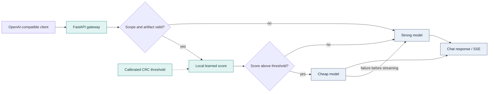
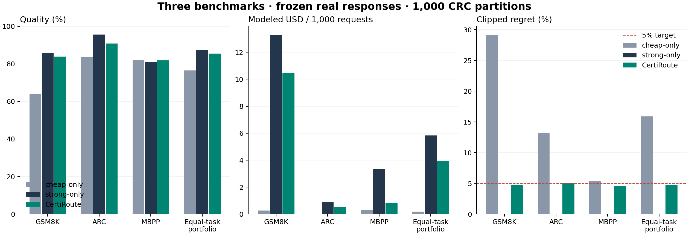
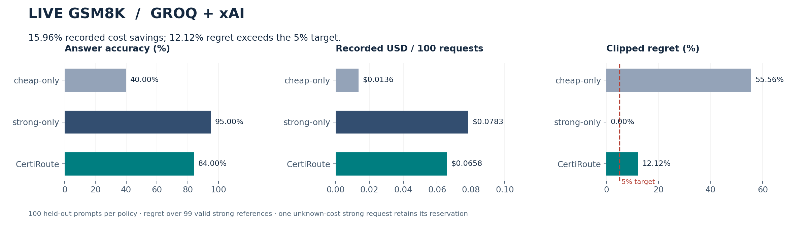
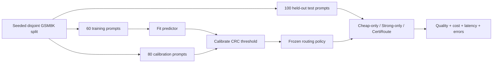
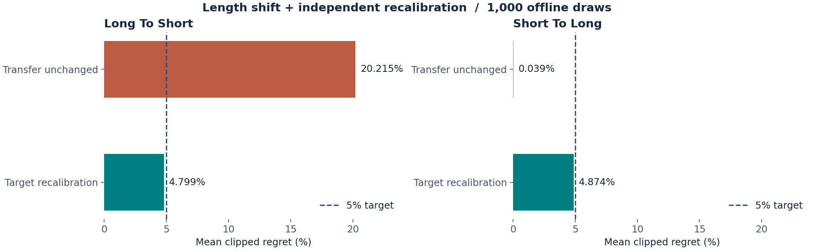
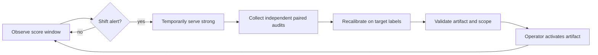
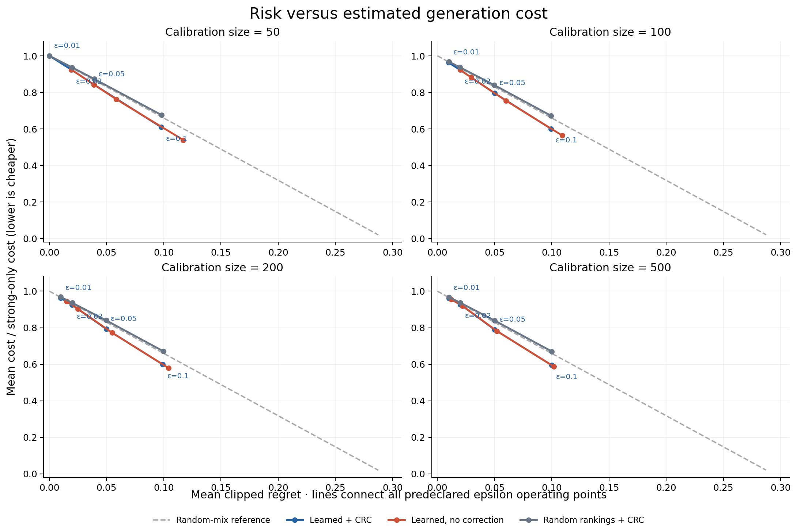
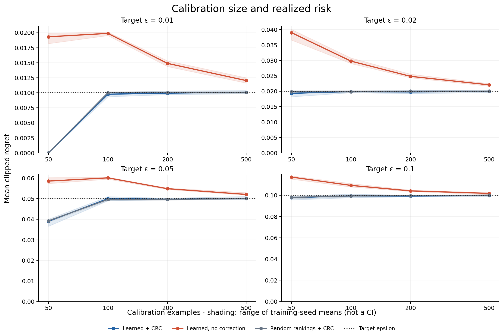
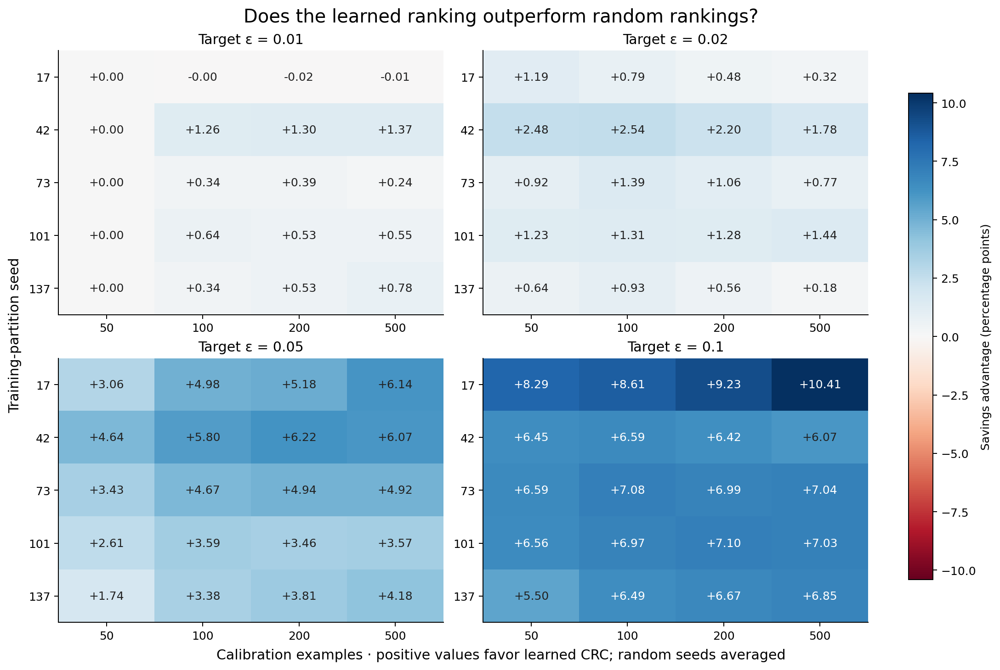
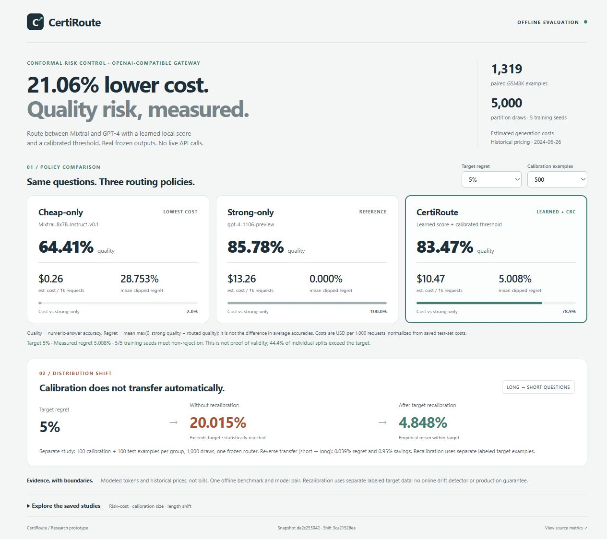

# CertiRoute

### Spend less on LLM calls. Measure the quality you give up.

[](https://github.com/balamuruganpg/CertiRoute/actions/workflows/ci.yml)


An **OpenAI-compatible gateway** combining a small learned router with **conformal
risk control (CRC)** to choose between cheap and strong models. Frozen datasets,
executable coding tests, drift experiments and a live provider study make the
quality/cost tradeoffs inspectable.

| Evidence | Cost finding | Quality / risk finding |
|---|---|---|
| **3 offline benchmarks** · 3,188 frozen pairs | **32.77% estimated savings** | **4.769% mean regret** at a 5% target |
| **Live Groq + xAI** · 100 held-out prompts | **15.96% recorded savings** | **12.12% regret: target missed** |
| **Length-shift replay** · 1,000 draws | Audit cost reported separately | **20.215% → 4.799%** regret after recalibration |

> **Evidence, not a production guarantee.** Offline and live studies use different
> model pairs and accounting. The live result does **not** demonstrate savings while
> meeting the 5% target. CRC requires its statistical assumptions; an individual
> test split can exceed the target.

[Quick start](#quick-start) · [Live results](#live-provider-results) ·
[Reproduce](#reproduce-without-api-keys) · [Architecture](ARCHITECTURE.md) · [Evaluation plan](EVALUATION.md)

## How routing works



**Seven local prompt features + logistic classifier.** No embedding service or
extra model call. A higher score favors cheap routing; CRC sets the threshold from
held-out paired labels. Artifacts bind model identities, predictor, metric and scope.

`regret = mean(max(0, quality_strong − quality_routed))`

Regret is **not** the difference between average accuracies. The target concerns
marginal expected regret under exchangeability, not correctness of every answer.

## Offline: three benchmarks



| Benchmark | Frozen pairs | CertiRoute quality | Mean regret | Estimated savings |
|---|---:|---:|---:|---:|
| GSM8K · math | 1,319 | 83.92% | 4.728% | 21.27% |
| ARC-Challenge · science QA | 1,470 | 90.74% | **5.030%** | 41.78% |
| MBPP · executable Python | 399 | 81.81% | 4.549% | 75.93% |
| **Equal-task portfolio** | **3,188** | **85.49%** | **4.769%** | **32.77%** |

**1,000 calibration/test draws per task.** Three duplicate MBPP records are removed
before splitting. Code is scored with isolated containerized base tests; ARC labels
come from RouterBench. Costs use historical rates and estimated tokens. Separate
artifacts per task, with a different cheap coding model: this is a task-specific
portfolio, not one globally calibrated router.

ARC's mean slightly exceeds 5%; its adjusted interval does not reject the target.
Non-rejection is not proof of validity.

[All baselines and metrics](results/multibench-v1/REPORT.md) ·
[Models, sources, scoring and prices](docs/MULTIBENCH.md) · [Data notices](data/eval/multibench/NOTICE.md)

## Live provider results



**Groq `openai/gpt-oss-20b` + xAI `grok-4.20-0309-non-reasoning`**, collected
2026-10-30. Fresh training and calibration; unchanged 5% target.



| Policy | Quality | Recorded USD / 100 requests | Regret | p50 / p95 latency | Errors |
|---|---:|---:|---:|---:|---:|
| Cheap-only | 40% | $0.0136 | 55.56% | 0.88 / 2.21 s | 0% |
| Strong-only | 95% | $0.0783 | 0% | 1.54 / 2.31 s | 1% |
| **CertiRoute** | **84%** | **$0.0658** | **12.12%** | **1.47 / 2.33 s** | **0%** |

**The live empirical target was missed.** Regret uses 99 valid strong references;
accuracy includes all 100 requests. One unknown-cost strong request retains its
reservation. Groq uses actual usage × recorded prices; xAI reported USD ticks take
precedence. Latency excludes pacing and network ingress to the in-process gateway.

Full-study acquisition + testing: **$0.3008**. Cumulative recorded spend/reservations,
including earlier runs and pilots: **$0.3614**. The 256-token cap can truncate cheap-model
reasoning; the cause of the risk miss has not been established.

[Report and exact prices](results/live-gsm8k-v1/REPORT.md) ·
[Frozen observations](results/live-gsm8k-v1/observations.jsonl) · [Collection and recovery](docs/LIVE_MEASUREMENT.md)

## Drift: detect, audit, recalibrate





The replay observes 100 requests, collects 100 independent paired audits while serving
strong, then evaluates on 100 disjoint target examples. Long-to-short regret changes
from **20.215%** to **4.799%** after recalibration. This is abrupt length shift within
GSM8K; continuous production monitoring and automatic activation remain unvalidated.

[Replay report](results/drift-v1/REPORT.md) · [Operator procedure](docs/DRIFT.md)

## Earlier GSM8K sensitivity study

**21.06% estimated savings** with **5.008% measured regret** at a 5% target: 1,319
real Mixtral/GPT-4 pairs, five training seeds and 5,000 partition draws. This operating
point is separate from the expanded three-benchmark study above.



<details>
<summary><strong>More sensitivity plots and dashboard preview</strong></summary>





The dashboard displays the original GSM8K sensitivity/shift snapshots, not the expanded
results above. It is not a live operations monitor.

</details>

[Sensitivity report](results/gsm8k-sensitivity/REPORT.md) · [Original shift report](results/gsm8k-shift/REPORT.md)

## Quick start

**No API keys needed** to inspect the dashboard, replay frozen evaluations or verify
the live snapshot. Dependency installation requires internet access.

```bash
git clone https://github.com/balamuruganpg/CertiRoute.git
cd CertiRoute
python -m venv .venv
```

Activate with `source .venv/bin/activate` on macOS/Linux, or
`.\.venv\Scripts\Activate.ps1` in Windows PowerShell. Then:

```bash
python -m pip install -r requirements-eval.lock
python -m pip install -e . --no-deps
python -m uvicorn certiroute.dashboard.app:app --host 127.0.0.1 --port 8765
```

Open [localhost:8765](http://127.0.0.1:8765). [Dashboard guide](dashboard/README.md) · [Gateway setup](docs/DEVELOPMENT.md)

## Reproduce without API keys

Run from the repo root. Use fresh output directories; saved studies are immutable.

```bash
# Recompute metrics and re-score the frozen live test outputs (quick)
python -m eval.publish_live --verify results/live-gsm8k-v1

# Re-run the three-benchmark CRC comparison from frozen pairs
python -m eval.multibench --out results/reproduced/multibench

# Re-run drift detection and independent target recalibration
python -m eval.drift --out results/reproduced/drift

# Render the new README figures from published results
python -m pip install -r requirements-plot.lock
python -m eval.plot_portfolio --out results/reproduced/portfolio-plots
```

The statistical replays use already-scored MBPP fixtures. Independently rerunning
untrusted code requires Docker; follow the [containerized scoring procedure](docs/MULTIBENCH.md).
Recollecting live outputs is paid and not bit-reproducible. The [live guide](docs/LIVE_MEASUREMENT.md)
starts with a bounded pilot and preserves the budget journal across acquisition resumes.

<details>
<summary><strong>Original studies, other plots and engineering checks</strong></summary>

```bash
python -m eval.sensitivity --out results/reproduced/gsm8k-sensitivity
python -m eval.shift --out results/reproduced/gsm8k-shift
python -m eval.plot_expansion --input results/reproduced/multibench/results.json --out results/reproduced/multibench/plots
python -m pytest -q
python -m ruff check src eval tests
python -m mypy src eval
```

CI runs pytest, Ruff and mypy on Python 3.12 and 3.13. Reliability coverage includes
timeouts, fallback and 32 concurrent requests. Full coding replays remain separate
from CI. Large per-draw logs are regenerated locally; saved reports retain checksums.

</details>

## Limitations and next evidence

- **Live target missed:** 12.12% versus 5% in one 100-prompt test draw. Investigate and
  repeat independently before claiming live validity; no post-hoc tuning on this test set.
- **Costs differ:** offline tokens and historical costs are modeled. Live accounting
  mixes token-price estimates, provider charges and unknown-cost reservations; it is
  not a reconciled invoice. Test savings exclude acquisition and serving overhead.
- **Benchmark traffic, not production:** small live sample, sequential nonstreaming
  calls; no production load/soak or internet-facing gateway latency validation.
- **Transfer is conditional:** task/model pairs need their own artifacts. Shift can
  break calibration; recalibration needs independent labeled target data.
- **Finite data and scorers:** public benchmark contamination, imported ARC labels,
  MBPP base-test coverage and numeric-answer parsing limit the conclusions.

## Project map

| Area | Entry point |
|---|---|
| Gateway and provider adapters | [src/certiroute](src/certiroute) · [architecture](ARCHITECTURE.md) |
| Learned routing and CRC artifacts | [router](src/certiroute/router) · [calibration](src/certiroute/calibration) |
| Data and evaluation evidence | [eval](eval) · [results](results) · [evaluation plan](EVALUATION.md) |
| Drift and live measurement | [drift guide](docs/DRIFT.md) · [live guide](docs/LIVE_MEASUREMENT.md) |
| Milestones and responsibilities | [roadmap](ROADMAP.md) · [split](SPLIT.md) · [skills](SKILLS.md) |

Research prototype. Claims are tied to frozen evidence, and unsuccessful outcomes stay visible.
