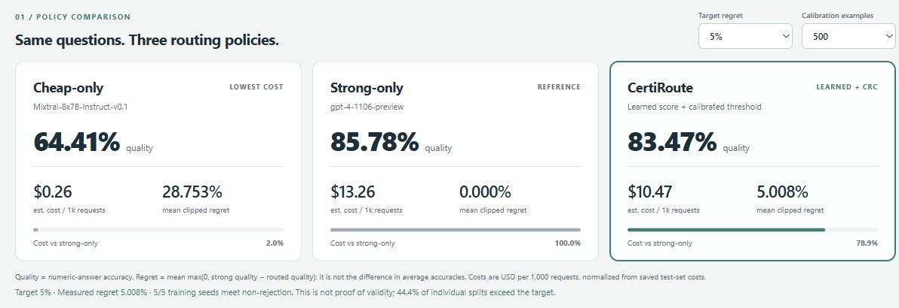
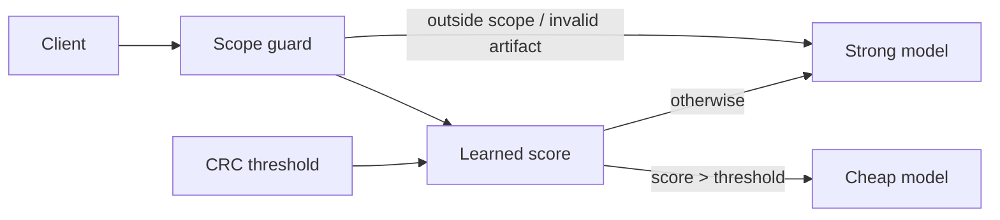

# CertiRoute

## 21% lower estimated cost at a 5% target regret

An OpenAI-compatible LLM gateway that routes between cheap and strong models
using a learned difficulty score and **conformal risk control (CRC)**.

**Shift finding:** the calibrated guarantee fails under unmitigated long-to-short
question-length shift: **20.015% regret** at a 5% target. Recalibration on separate
target examples restores empirical regret to **4.848%**, consistent with the
risk target in this offline study. This is not a production guarantee.

`Python 3.12+` · `FastAPI` · `JSON + SSE` · `Offline / no API keys` · `Research prototype`

[Run the dashboard](#run-locally) · [Reproduce](#reproduce-the-main-result) ·
[Architecture](ARCHITECTURE.md) · [Evaluation plan](EVALUATION.md)



| Same held-out questions | Cheap-only | Strong-only | **CertiRoute** |
|---|---:|---:|---:|
| Quality / numeric-answer accuracy | 64.41% | 85.78% | **83.47%** |
| Estimated USD / 1,000 requests | $0.26 | $13.26 | **$10.47** |
| Mean clipped regret | 28.753% | 0% | **5.008%** |
| Estimated savings vs strong-only | 98.03% | 0% | **21.06%** |

**Evidence:** 1,319 real frozen GSM8K response pairs · 5 training seeds ·
5,000 partition draws · 500 calibration examples at this operating point.
Cheap: `mistralai/Mixtral-8x7B-Instruct-v0.1`; strong: `gpt-4-1106-preview`.

Regret is `mean(max(0, q_strong − q_routed))`, **not** the difference in average
accuracies. The measured 5.008% is slightly above 5%; all five training seeds meet
the adjusted non-rejection criterion. Non-rejection is not proof of validity.
[Full metrics and methodology →](results/gsm8k-sensitivity/REPORT.md)

## What is built

| Component | Implemented |
|---|---|
| Gateway | OpenAI-compatible chat completions, JSON/SSE forwarding, strong fallback |
| Learned router | Seven local prompt features; small logistic classifier; no embedding service |
| Calibration | Strict `score > threshold` routing; bounded-regret CRC; validated JSON artifacts |
| Offline evaluation | Frozen real outputs, reproducible splits, baselines, size/seed sensitivity |
| Shift study | Both length-shift directions, source controls, target recalibration |
| Dashboard | Read-only comparison, operating-point controls, saved study plots |



CRC targets expected clipped regret under exchangeability with calibration data.
It is a marginal guarantee, not a promise about each answer or each test split.
[Architecture](ARCHITECTURE.md) · [Theory and evaluation](EVALUATION.md)

## Measured tradeoffs

### Cost versus risk

The learned router saves **21.06%** at the headline setting, versus **16.09%** for
random ranking + CRC. Higher savings from an uncorrected threshold come with
higher regret. All operating points remain visible in the saved report.


### Distribution shift breaks transfer

At a 5% target, calibrating on long questions and testing on short ones fails
at every repeated split. Target recalibration uses **separate labeled examples**;
it never reads the target test labels to set a threshold.

| Direction / intervention | Mean regret | Outcome |
|---|---:|---|
| Long → short, no recalibration | **20.015%** | Target rejected; adjusted CI [19.659%, 20.371%] |
| Recalibrated → same short test sets | **4.848%** | Mean within target; no rejection |
| Short → long, no recalibration | 0.039% | Conservative; only 0.95% savings |
| Recalibrated → same long test sets | 5.022% | Slightly above target; no statistical rejection |


This is a covariate shift **within GSM8K**, not the planned cross-dataset study.
Both directions and all four target regrets were fixed before this run.
[Shift report](results/gsm8k-shift/REPORT.md) · [Protocol](docs/GSM8K_SHIFT.md)

<details>
<summary><strong>Calibration-size and seed sensitivity plots</strong></summary>


Calibration sizes: 50 / 100 / 200 / 500. Five training seeds and five random
rankings. Learned CRC meets non-rejection in 80/80 cells; the no-CRC baseline
is rejected in 70/80. The learned ranking loses some seed comparisons at tighter
targets. [Full report](results/gsm8k-sensitivity/REPORT.md).

</details>

## Run locally

Clone the repository and run from its root. **No provider keys are needed.**
The dashboard uses the included published results and makes no model calls.

```bash
git clone https://github.com/balamuruganpg/CertiRoute.git
cd CertiRoute
python -m venv .venv
```

Activate the environment:

```bash
# macOS / Linux
source .venv/bin/activate
```

```powershell
# Windows PowerShell
.\.venv\Scripts\Activate.ps1
```

Install once (package installation may need network access), then launch:

```bash
python -m pip install -r requirements-eval.lock
python -m pip install -e . --no-deps
python -m uvicorn certiroute.dashboard.app:app --host 127.0.0.1 --port 8765
```

Open **[localhost:8765](http://127.0.0.1:8765)**. Select a target regret and calibration
size; the three cards update from the same saved sensitivity study. The shift
panel is a separate 100-calibration-example experiment, labeled accordingly.
No fonts, JavaScript libraries or chart services are fetched from a CDN.

<details>
<summary><strong>Dashboard preview</strong></summary>


</details>

[Dashboard configuration](dashboard/README.md) ·
[Gateway setup and real-provider configuration](docs/DEVELOPMENT.md)

## Reproduce the main result

With the environment above installed, run entirely offline from the included
paired dataset. Use new output directories; saved studies are not overwritten.

```bash
# Rebuild the 21.06% headline result, all sizes/seeds and baselines
python -m eval.sensitivity --out results/reproduced/gsm8k-sensitivity

# Rebuild the length-shift and target-recalibration comparison
python -m eval.shift --out results/reproduced/gsm8k-shift
```

Each run saves **REPORT.md, results.json, router weights, partitions, metrics and
provenance hashes**. Protocols and predeclared settings:
[sensitivity](docs/GSM8K_SENSITIVITY.md) · [shift](docs/GSM8K_SHIFT.md).

The repository includes paired inputs, aggregate results, frozen weights and plots.
Large per-draw logs are generated by the commands above rather than stored in Git;
their expected checksums are retained in the published result files.

<details>
<summary><strong>Render plots, inspect a new run, and run checks</strong></summary>

Install the optional pinned plotting dependencies once, then render offline:

```bash
python -m pip install -r requirements-plot.lock
python -m eval.plot_sensitivity --input results/reproduced/gsm8k-sensitivity/results.json --out results/reproduced/gsm8k-sensitivity/plots
python -m eval.plot_shift --input results/reproduced/gsm8k-shift/results.json --out results/reproduced/gsm8k-shift/plots
```

To inspect those results in the dashboard, set `CERTIROUTE_RESULTS_DIR` to
`results/reproduced` before starting it. See [platform-specific commands](dashboard/README.md).

```bash
python -m pytest -q
python -m ruff check src eval tests
python -m mypy src eval
```

The [original repeated-split study](docs/GSM8K_REPEATED.md) includes a first-draw
agreement check between offline scores and actual gateway replay.

</details>

## Limitations

- **Modeled costs, not bills.** Tokens are estimated as `ceil(characters / 4)`.
  Historical June 2024 rates: Mixtral $0.24/M input/output; GPT-4 $10/M input and
  $30/M output. Savings exclude calibration/audit acquisition and serving overhead.
- **Offline evidence only.** One public math benchmark and model pair; no live
  production traffic. Repeated draws reuse the same finite pool. Benchmark
  contamination and scorer limitations remain threats to validity.
- **Recalibration under shift.** A calibrated threshold can fail on a changed
  distribution. Target recalibration helps in this study, but assumes labeled
  target data; online drift detection and automatic recalibration remain planned.
- **Statistical scope.** Marginal expected regret under exchangeability, not a
  per-request guarantee. The reported Monte Carlo intervals are conditional on
  the fixed dataset; non-rejection does not establish deployment safety.

## Engineering notes

| Read more | Purpose |
|---|---|
| [ARCHITECTURE.md](ARCHITECTURE.md) | Request flow, scope checks, artifact contracts and failure behavior |
| [EVALUATION.md](EVALUATION.md) | Claims, baselines, statistical criteria and remaining studies |
| [ROADMAP.md](ROADMAP.md) | Milestones from MVP to monitoring and broader validation |
| [SPLIT.md](SPLIT.md) / [SKILLS.md](SKILLS.md) | Systems/theory responsibilities and required knowledge |
| [Data provenance](data/eval/gsm8k-full/NOTICE.md) | Public snapshot, source attribution and scoring assumptions |

**Next:** cross-dataset shift, audit-driven monitoring and live-provider cost/latency
measurements. This dashboard presents offline evidence; it is not an operations monitor.
