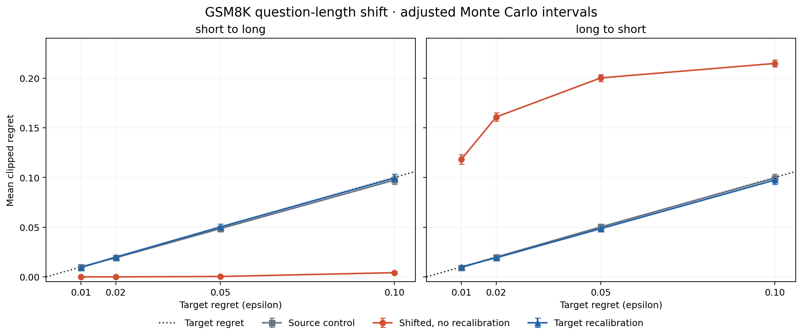

# Offline GSM8K distribution-shift experiment

The [saved report](../results/gsm8k-shift/REPORT.md) tests source calibration,
unmitigated transfer and target recalibration on real frozen Mixtral/GPT-4
outputs. It is a within-dataset covariate-shift study supporting EVALUATION.md
§8 and G6, not completion of S1's planned transfer to MATH, ARC or code.

## Fixed protocol

- The existing prompt-hash split with seed 42 selects 527 router-training rows.
  The same seven-feature logistic model is fitted once; no features or settings
  are changed in response to the shift results.
- The median question length of those training rows is 227 Unicode characters.
  Length excludes the eight shared demonstrations and the Question/Answer
  wrapper. Full prompts still feed the predictor and cost calculation.
- The 792 remaining questions split into 428 short (at or below the median)
  and 364 long questions. Neither the grouping rule nor boundary uses their
  labels. Length is not asserted to be a ground-truth difficulty label.
- `configs/study.shift.yaml` fixes seed 42, 1,000 draws, 100 calibration and
  100 test examples per group, and confidence 0.95. Each draw independently
  shuffles each group, takes calibration then test, and excludes unused rows.
  Training, calibration and test are disjoint within every evaluated arm.
- Both directions and all existing epsilons (0.01/0.02/0.05/0.10) are evaluated.
  **Source-control** calibrates and tests within the source group.
  **Shifted** applies that same threshold to the target test set.
  **Target-recalibrated** uses separate target calibration examples and the
  identical target test set. Test outcomes never choose any threshold.
- All arms call the production `crc_lambda` and use strict `score > threshold`
  routing with per-example clipped regret. The gateway itself is unchanged.
  This experiment operates on frozen scores; the earlier G1 report contains
  the independent gateway-replay agreement check.

## Findings

At epsilon 0.05, long-to-short transfer produces mean regret **0.20015**,
with an adjusted Monte Carlo interval **[0.19659, 0.20371]**. It exceeds the
target in every draw. Recalibrating on separate short examples gives **0.04848**
mean regret and **22.24% estimated savings** on the same short test sets.

Short-to-long transfer instead gives **0.00039** regret and **0.95% savings**:
the transferred threshold is conservative. Recalibration on long examples
increases savings to **16.51%**, with mean regret **0.05022** and adjusted
interval **[0.04719, 0.05325]**. That mean is slightly above the target but
does not reject the plan's criterion. The report includes every epsilon.

Long questions have higher cheap-only regret (0.35440 vs 0.23832), yet the
failure occurs in the opposite transfer direction. Aggregate task difficulty
alone does not explain transfer: the fixed score/threshold policy routes
short questions much more aggressively under the long-calibrated threshold.
The result demonstrates that calibration is tied to its distribution.



## Statistical interpretation

Report both `mean_within_target` (observed mean <= epsilon) and `non_rejection`
(adjusted lower CI <= epsilon). They answer different questions. Approximate
normal Monte Carlo intervals use whole independent partition draws as the units,
conditional on the fixed training set and finite pools. Bonferroni covers all
24 direction/arm/epsilon cells, including overlapping controls; it is conservative.
Dependence between arms is not counted as additional independent data.
The same-group control in one direction equals the recalibrated arm in the
other because they intentionally share partitions.

All eight unmitigated shifted settings are reported: long-to-short rejects at
all four epsilons, short-to-long at none. All source controls and recalibrated
settings meet non-rejection; this is not a proof of population validity.
Individual split exceedances alone do not invalidate a marginal CRC guarantee.

## Reproduce without network calls

From the repository root with the existing project dependencies installed:

```powershell
.\.venv\Scripts\python -m eval.shift --out results/my-gsm8k-shift
```

Defaults use the included full dataset, its gateway template, historical GSM8K
pricing and `configs/study.shift.yaml`. `--input`, `--config`, `--pricing` and
`--study` select explicit alternatives. New output directories are required.
No downloads, keys or provider calls occur.

For plots, use a Python environment with `requirements-plot.lock` installed:

```powershell
python -m eval.plot_shift --input results/my-gsm8k-shift/results.json --out results/my-gsm8k-shift/plots
```

The recorded run uses project Python 3.13.14 for analysis and the existing
Python 3.11 / Matplotlib 3.10.8 / NumPy 2.2.6 environment for figures.
Plotting does not import the gateway or require any new runtime dependency.

Saved artifacts include:

- `results.json` and `REPORT.md`: all metrics, intervals, config, source manifest,
  exact model/prompt/decoding/pricing metadata, source-code hashes and limitations.
- `train.json` / `router.json`: frozen training inputs and fitted weights.
- `pool-scores.json` / `split-manifest.json`: scores, labels, costs, ordered IDs,
  lengths, boundary, group membership and deterministic partition algorithm.
- `draws.jsonl`: every partition's pool indices, thresholds and measurements.
- `plots/`: PNG/SVG/PDF plus input, script, library and output provenance.

## Remaining limitations

Real model outputs replace synthetic quality numbers, but token counts are
approximated from text and costs use historical rates rather than measured bills.
The original provider deployment, generation dates and exact top-p are not known.
No live production traffic or new provider calls are involved.

These rows were already inspected in earlier studies; this is not a fresh
holdout for model selection. One seed, one benchmark and one model pair do not
establish broad robustness. Lexical deduplication does not rule out semantic
duplicates or benchmark contamination.

Recalibration assumes 100 fully labeled target examples are already available.
Its acquisition cost is excluded from routed-generation savings. No automatic
shift detector, audit budget, detection delay or online recalibration mechanism
is tested. Cross-dataset S1 and the S3 monitoring study remain future work.
